<style>
table {
    font-size: 0.8em;
}
</style>

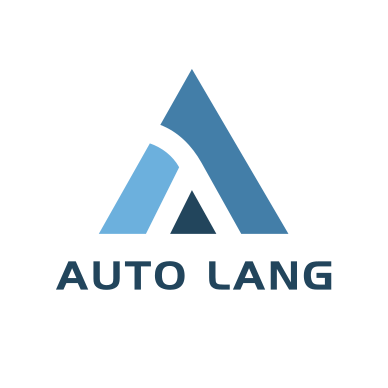


# **Auto & LaOS**
<br/>

### 操作系统
<br/>

### 编程语言
<br/>

### 车载嵌入式开发
---

## **主线**

- **理想 vs 现实**
- 观察问题：车载嵌入式领域
- 解决思路：操作系统
- 实现方案：Auto语言
    - 语言即系统：Language as OS (LaOS)

---

## **理想**


<br/>

**One Ring to Rule Them All**

<br/>
<br/>
<br/>
<br/>
<br/>

<small><small><small>* 其实就是懒</small></small></small>


---

## **理想：程序员**

<style scoped>
ul {
    font-size: 0.8em;
}
</style>


<br/>

**One Codebase to Rule Them All**

<br/>

- 写一套代码，就可以完成所有任务。


---

## **理想：操作系统**

<br/>

**One OS to Rule Them All**

<br/>

<style scoped>
ul {
    font-size: 0.8em;
}
</style>

- 自由切换硬件
- 一致的使用体验


---

## **理想：编程语言**

<br/>

**One Lang to Rule Them All**

<style scoped>
ul {
    font-size: 0.8em;
}
</style>

<br/>

- 自由切换开发环境
    - 操作系统
    - 硬件平台
    - IDE/Editor
- 一致的开发体验

<br/>


---

## **现实：车载嵌入式开发**


---

## **车载四大域**

<style scoped>
ul {
    font-size: 0.8em;
}
</style>

<br/>

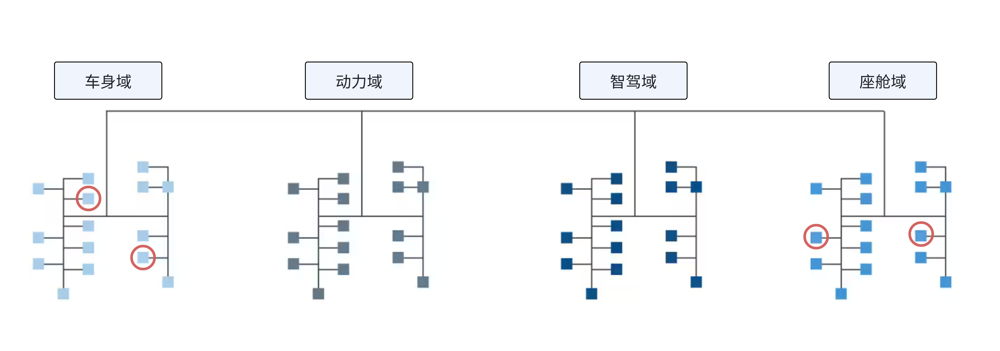

---

## **汽车系统**

<style scoped>
section {
    columns: 2;
}

h2 {
    column-span: all;
}

h3 {
    break-before: column;
}

</style>

### 角色


- 车厂
- 供应商
- 芯片厂
- 软件服务商

### 关系

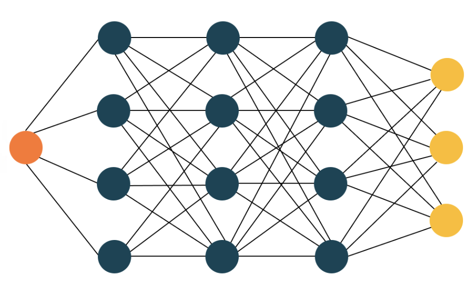

---


## **时间线**

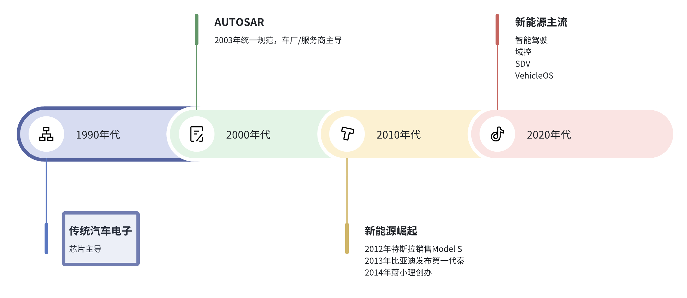

---


## **开发流程：传统时代**

<style scoped>
ol {
    font-size: 0.8em;
}
</style>

1. 选择芯片
2. 阅读芯片手册
3. 芯片厂提供的基础配置工具
4. 选择IDE
5. 生成初始化代码
6. 调用SDK或直接操纵寄存器编程
7. 通讯网络自己开发
8. 服务层和应用层都是自己开发

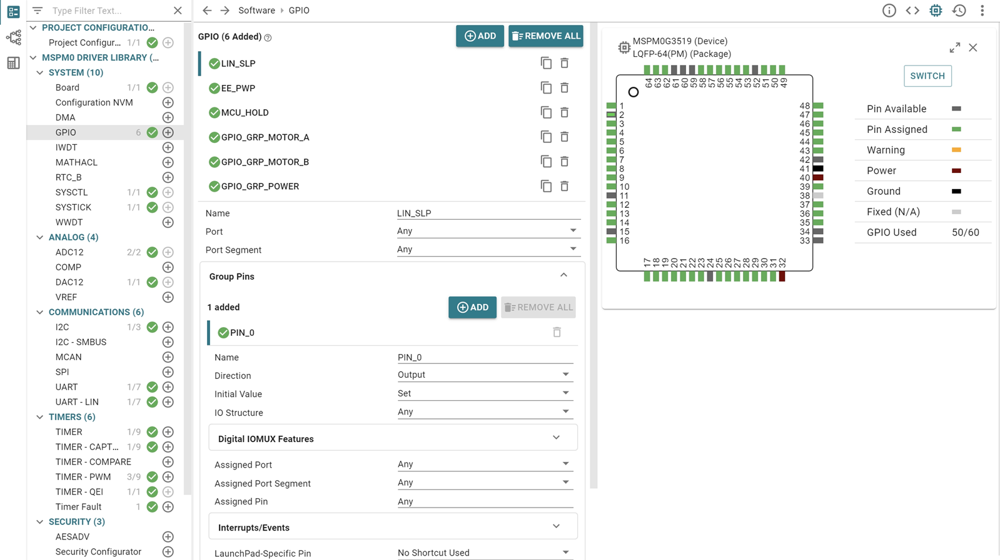

---

<style scoped>
section {
    columns: 2;
}

h2 {
    column-span: all;
}

h3 {
    break-before: column;
}

</style>

## **问题观察**

硬件决定了系统复杂度

<style scoped>
li {
    font-size: 0.8em;
}

table {
    font-size: 0.7em;
}
</style>

<br/>


1. 芯片、配置工具、编译器、IDE、网络
1. 几乎所有的选择都要用C代码来实现
2. 每个选择引入新的差异
3. 涉及到系统的每个层次
5. 唯一好用的配置工具，每家都不同

### 

维度 |  区别
--- | ---
芯片 | SDK代码、启动代码
配置工具 | 引脚初始化、SDK代码
编译器 | C语言扩展、汇编、标准库
IDE | 目录结构、依赖关系
调试设备 | 输出文件、下载方式、调试方式
网络协议 | 通讯方式、数据格式
RTOS | 任务调度、数据传输

---

## **操作系统如何处理这个问题？**
<style scoped>
section {
    columns: 2;
}

h2 {
    column-span: all;
}

h3 {
    break-before: column;
}

</style>

<style scoped>
ul {
    font-size: 0.8em;
}
</style>

### 抽象

- 虚拟驱动：统一同类型的硬件
- HAL：统一硬件功能接口
- 系统调用：统一系统服务
- 文件系统：统一数据存储
- 编译工具链：Autotools/CMake
- 配置：基于文件
- 配置工具：shell/UI
- 包管理器


### 分层

- 应用软件层
    - 数据访问层
    - 服务访问层
- 硬件访问层
    - 驱动层
    - 硬件抽象层

---

## **解决方案：传统时代**

<style scoped>
section {
    columns: 2;
}

h2 {
    column-span: all;
}

h3 {
    break-before: column;
}

ul {
    font-size: 0.8em;
}

</style>

### 抽象

- HAL
    - 芯片厂商提供自己的HAL
    - 车厂、供应商、甚至开发团队都有自己的HAL层
- 系统服务：
    - 按照硬件功能划分模块
- 数据存储：
    - 静态配置：生成C结构体代码
    - NvM：基于Block
    - 文件系统：无

### 分层

- 应用软件层
- 服务层
- 硬件访问层

#### 问题

- 各家不统一
- 没有数据的抽象，还在玩字节和比特
- 没有配置文件，用C代码来区别
---

## **为什么不用配置文件?**

C语言：“你以为臣妾不想吗？”

<style scoped>
ul {
    font-size: 0.8em;
}
</style>

<br/> 

- 配置文件怎么读？
    - 连文件系统都没有！
- JSON/XML格式存储配置？
    - 连`malloc`都没有！
- 二进制文件寸土必争
    - 文本形式太占空间
- 还有宏可以用...
    - 还得编译工具帮忙


---

## **时间线：AUTOSAR**

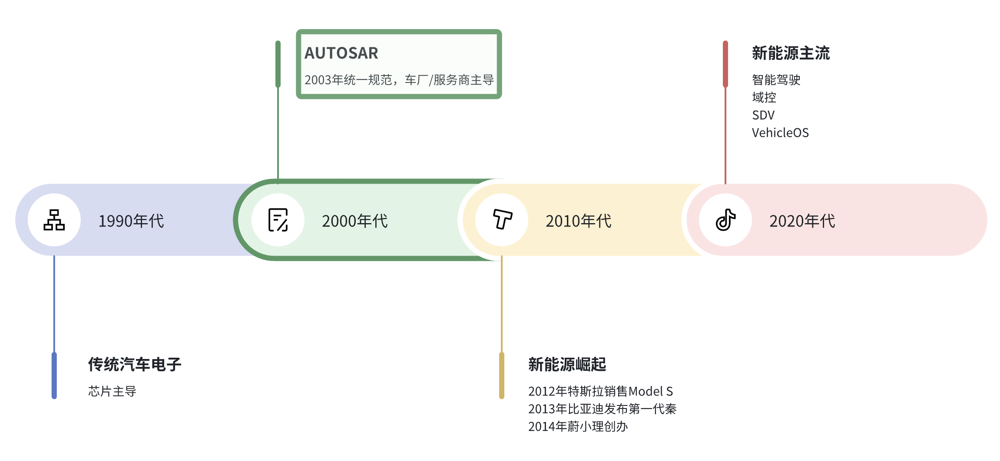


---

## **解决方案：AUTOSAR**

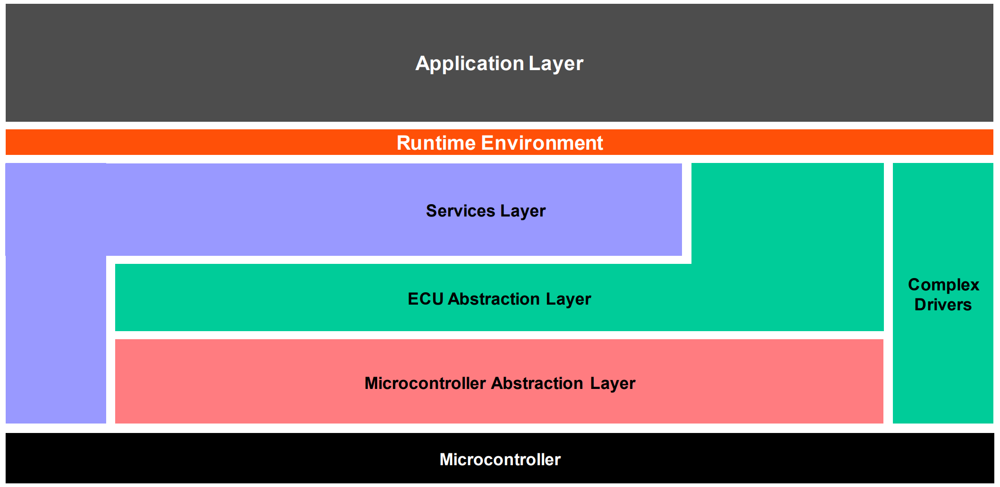

---

## **AUTOSAR**

<style scoped>
ul {
    font-size: 0.8em;
}
</style>

- 行业统一
    - 初步实现了硬件切换自由
- MCAL
    - 在HAL/SDK上再抽象一层
- 基于UI的配置
    - 配置文件为ARXML
    - 生成C代码

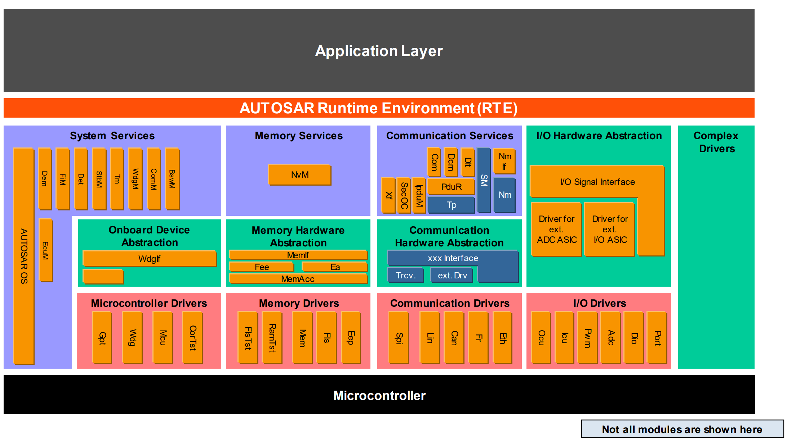

---

## **开发体验：AUTOSAR**

<style scoped>
ol {
    font-size: 0.8em;
}
</style>

1. 选择硬件
2. 购买对应的AUTOSAR软件包和配置工具
3. 利用配置工具配置代码
    - 配置MCAL
    - 配置和中间层各个模块
    - 配置网络协议栈
    - 配置RTE
4. 生成代码
5. 修改应用层时，大概率仍然需要重新配置RTE

---

## **AUTOSAR配置界面**

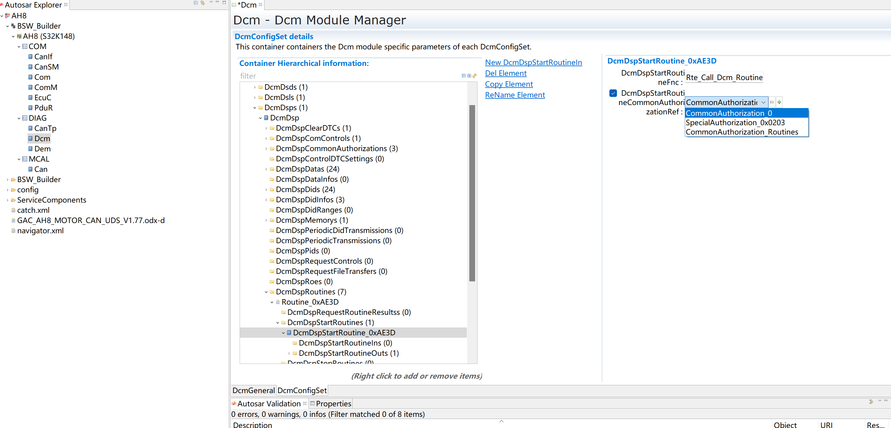

--- 
## **AUTOSAR的问题**

<style scoped>

section {
    columns: 2;
}

h2 {
    column-span: all;
}

h3 {
    break-before: column;
}

ul {
    font-size: 0.8em;
}

</style>

### 问题

- 工具昂贵
- 硬件支持不一，各有各的小圈子
- 配置繁琐，且信息分散
- 配置与代码不同步
- 生态封闭，黑盒操作

### 新的商机？

- 现场配置员？
- 收费适配新硬件

#### 恶性循环

 - 收费->没有改善动力->更难用->收费更高

---

## **AUTOSAR的问题：根源**

- 对UI配置的过度使用，反而和C脱节了
- UI配置对应的XML太过繁杂
- 商业模式问题：越难用越有商机

这段时间，Vector逐渐脱颖而出，成为服务商的老大。
车厂对服务商的依赖变大。

---

## **时间线：新能源崛起**

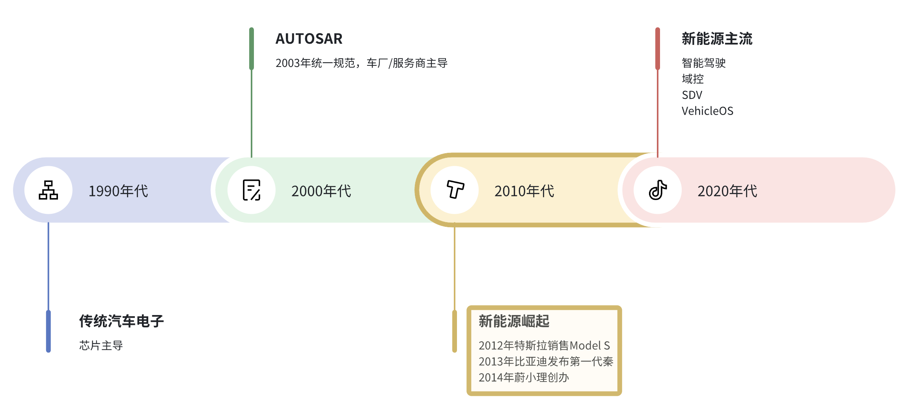

---

## **AUTOSAR的新困境**

- SOC崛起
    - MCU -> SOC
    - RTOS -> Linux/Android
    - C -> C++/Java
    - CAN/LIN -> ETH
- 全新的玩家，全新的生态，全新的开发模式
- 裹足不前的AUTOSAR
- 车厂把很多开发工作收回

---

## **解决方案：AUTOSAR AP**

<style scoped>
ul {
    font-size: 0.8em;
}
</style>

- 把之前的AUTOSAR改名叫CP（Classic Platform）
- 新的方案叫AP（Adaptive Platform）
- C -> C++
- RTOS -> Linux中间件
- 配置工具
    - 老壶装新酒
    - 更贵了
- 生态仍然封闭
- 结果，AUTOSAR AP没有能够流行起来
- 最重要的原因是国内车厂有Linux/Android了，可以直接用操作系统的办法去解决。

---

## **Vector AP：配置语言DML**

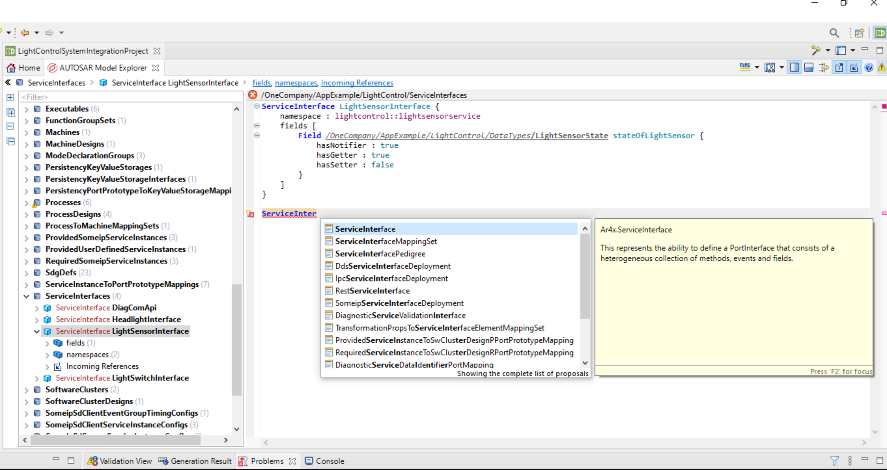

---

## **ARXML vs DML**

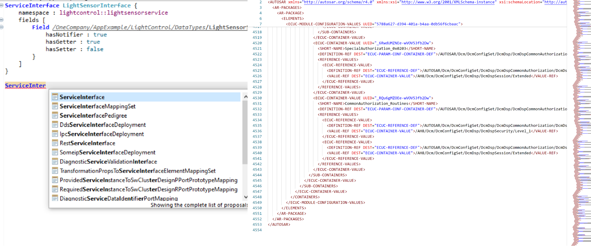

---

## **DML**

<style scoped>
section {
    columns: 2;
}

h2 {
    column-span: all;
}

h3 {
    break-before: column;
}

ul {
    font-size: 0.8em;
}
</style>

### 优点

- 终于可读可编辑了
- 简洁性
- UI和配置文件同步
- 信息唯一度
- 可以利用git/diff等文本工具

### 问题

- AP没人用
- 但却没有更新到CP
- 封闭生态
- 配置与C代码仍然分离

---

## **AUTOSAR：总结**

- 理想：
    - 想实现类似Linux的系统，解决硬件碎片化问题。
- 现实：
    - 实现了一个拙劣的C语言编译器。
    - 硬件碎片化解决了一部分，但引入了新的配置工具碎片化问题。
    - 所有的配置最终还是要落地到C语言。

---


## **时间线：新时代**

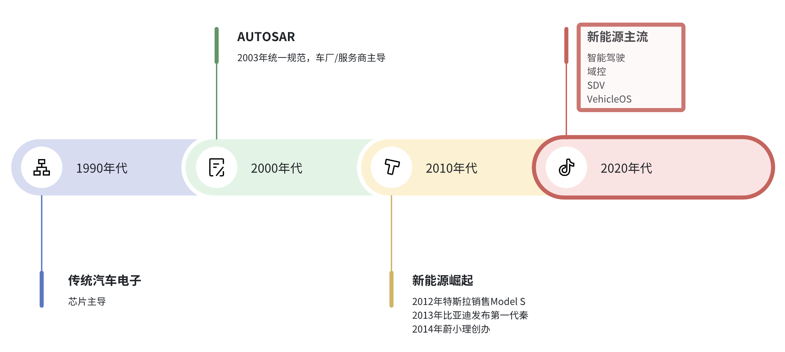

---

## **新时代的新发展**


<style scoped>
section {
    columns: 2;
}

h2 {
    column-span: all;
}

h3 {
    break-before: column;
}
</style>

### 软件定义汽车（SDV）

- 整个行业从硬件主导转向软件主导
- 操作系统成为车载软件的核心。
- 中国汽车工业协会发布SDV标准
    - 虚拟ECU层
    - 原子服务层

### 开放趋势
- 2024年6月，普华基础软件开源了AUTOSAR CP系统“小满”
- 2025年3月，理想开源了整车操作系统“理想星环”

---


## **嵌入式开发：三个趋势**

<style scoped>
section {
    columns: 3;
}

h2 {
    column-span: all;
}

h3 {
    break-before: column;
}

ul {
    font-size: 0.8em;
}
</style>

### 飞升仙界

- 物理解决问题
- 直接用少数SOC来替代多个MCU
- 域控SOC集成度大大提升
- MCU从80+减少到20+

### 肉身成圣

- 用操作系统直接解决问题
- 用C语言实现模块化、可伸缩的操作系统
    - RT-Thread
    - Zephyr

### 神仙下凡

- 能不能用语言解决问题呢？
    - C++
    - Rust
    - Zig

---

## **神仙下凡**

<style scoped>
section {
    columns: 3;
}

h2 {
    column-span: all;
}

h3 {
    break-before: column;
}

ul {
    font-size: 0.8em;
}
</style>

### C++?

- 更好的模块化，但在资源受限时，问题和C是基本一样的。
- 工具链和C基本一致，适配不是问题
- 语言门槛比C高

### Rust?

- 更加安全
- 语言门槛高
- 工具链对MCU的适配不成熟，stm32/esp32
- 标准库和某些特性（如动态数组、闭包）需要动态内存
- `nostd`方案

### Zig?

- 最贴近“better C”的语言。
- 工具链对MCU的适配不成熟，很多芯片不支持

--- 

### **神仙下凡：天兵天将**

和C类似，这些语言也需要工具链帮助。

| 语言 | 配置文件 | 编译器 | 构建工具 | 其他辅助工具 |
|------|---------|---------|------------|---
| C++  | ini/xml| GCC/Clang | Make/CMake/XMake | shell, 脚本语言 |
| Rust | toml  | Rustc | Cargo | shell, 脚本语言 |
| Zig  | 结构体 | Zigc | Zig Build | shell, 脚本语言 |

<br/>

<small>
这里头Zig是最能够自己自足的，但zig编译器支持的芯片有限。
</small>

---

### **神仙下凡：境界压制**

<style scoped>
ul {
    font-size: 0.8em;
}
</style>

C++/Rust/Zig的最初是设计用在PC/Server和Linux/Windows上的：

- 语言特性丰富，很多特性涉及动态内存
- 标准库庞大，功能齐全
- 优化方向是运行性能，而不是代码尺寸
- 编译工具围绕GCC/LLVM

要在资源受限的MCU中运行，必须做到：

- 削减语言特性
- 裁剪标准库
- 改变优化策略
- 适配不同的硬件架构

---

### **神仙下凡：小结**

- 长期看，这些语言生态会扩张到MCU来
- 短期内MCU还是C语言的天下
- 高阶语言在资源受限时遇到诸多掣肘，需要逐步适配
- 就我们公司而言，还是只能坚持用C一段时间。

这就导致了Auto语言的诞生。

---

### **Auto语言**

<style scoped>
ul {
    font-size: 0.9em;
}
</style>

- 为什么选择做Auto语言？
    - C是车载MCU开发现阶段的唯一真神
    - C适合打ADC，但很依赖辅助
    - AUTOSAR的那套辅助反客为主了

- 一切围绕做强C生态
    - C能做的事情都转成C来做
    - C不能做的事情，Auto语言来实现，再翻译成C

- 两个启动方向
    - 配置语言：美化版、可编辑的C结构体
    - 增强C：给C增加安全性、模块化、OOP。

---

### **Auto语言的诞生历程：配置语言ACL**

1. 一开始只打算做配置语言，替代繁杂的ARXML
2. **ATOM**：强化且简洁版的JSON+XML
3. **ACL**：Auto Config Language，给ATOM引入可编程性
4. ACL的第一个应用：承载DBC/CDD/ODX的信息 
6. 修改ACL，使之可以成为模板
5. **AutoGen**：生成C结构体代码
7. 为了方便测试，给ACL添加了解释器，方便随时查看内容

至此：配置语言这个方向基本成型。

--- 

### **Auto语言的诞生历程：增强C**

1. 总结以往工程经验，打算搭建“能够自由切换芯片”的统一代码库
2. 调研CMake等构建工具，发现无法完全适配IAR/GHS/CCS等编译器
3. **AutoMan**：决定自制构建工具，用ACL作为配置语言
4. 不再满足模板形式生成C代码，改为直接从ACL生成C代码。
5. 萌生直接强化C语言概念
6. 语言超出了配置的范畴，ACL这个名字不再合适
7. 改名**AutoLang**，之前的动态配置部分，称为**AutoConfig**。

---

### **Auto语言的诞生历程：AutoUI**

1. 配置工具需要开发UI界面
2. 发现Zed，考虑到未来IDE的建设，选择Zed/GPUI作为底层
3. 采用动态解释的手段，生成动态组件。
4. 实现Live Reloading，修改UI代码立即可见。
5. GPUI突然大更新
6. 尝试静态转译Rust的手段，生成和手写Rust一致的UI代码
7. UI配置改为面向对象的语法形式

至此**AutoUI**初步成型，Auto语言进入了新的领域。

---

### **和其他语言对比**

| 语言 | 配置文件 | 编译器 | 构建工具 | 其他辅助工具 |
|------|---------|---------|------------|---
| C++  | ini/XML| GCC/Clang | Make/CMake/XMake | shell, 脚本语言 |
| Rust | toml  | Rustc | Cargo | shell, 脚本语言 |
| Zig  | 结构体 | Zigc | Zig Build | shell, 脚本语言 |
| Auto | AutoConfig | Auto | AutoMan| AutoShell, AutoScript |

<br/>

<small>
Auto的目标是在MCU中把C之外所有辅助工具的事情都做好。

换句话说，Auto是在用编程语言来模仿Linux/RTThread这样的操作系统。
</small>

---

## **语言即系统（Language as OS）：**

我们看看操作系统的主要工作：

- 多个程序一起运行，即任务调度机制
- 硬件驱动层，实现不同硬件的自由切换
- 系统服务，让所有程序都能调用最通用的功能
- 交互系统：
    - 文本：shell
    - 图形：UI

---

## **语言即系统（Language as OS）：比喻**

操作系统 | 编程语言
--- | ---
内核 | 基本语法
系统调用  | 标准库
硬件驱动 | 操作系统适配层
文件系统 | 配置、数据库
Shell | Scripting
图形界面 | UI库

---

## **语言即系统（Language as OS）：对比**

特性 | Linux | RTThread | Auto语言
--- | --- | --- | ---
**内核** | 宏内核 | 微内核 | 微内核
**系统接口** | POSIX系统调用 | 系统调用 | 模块化标准库
**任务调度** | 进程/线程 | 抢占式RTOS | std.task
**内存管理** | 虚拟内存 | 静态内存/动态内存 | 静态存量、动态类型
**文件系统** | ext4/xfs | DFS+模块化文件系统 | std.io
**网络协议** | Kernel Network stack| SAL+lwIPKit | std.net
**文本交互** | Bash/Fish | Finsh | AutoShell
**图形界面** | X11/Gtk/Qt | PersimUI | AutoUI
**模块化** | 较差 | 内核、组件模块化 | 语言特性、标准库模块化

---

### **语言即系统（Language as OS）：开发相关**

特性 | Linux | RTThread | Auto语言
--- | --- | --- | ---
**编译器** | GCC/Clang | GCC/Clang | Auto+C编译器
**构建工具** | CMake/XMake | Scons | AutoMan
**配置工具** | 配置文件/UI | 配置文件 | AutoConfig
**调试工具** | GDB/LLDB | GDB/LLDB | AutoDebug
**测试工具** | GTest/GMock | CMock | AutoTest
**文档工具** | Manual/Doxygen | Doxygen | AutoDoc

---

### **语言即系统（Language as OS）：总结**

<style scoped>
ul {
    font-size: 0.8em;
}
</style>

- 微内核：最小内核支持bare metal
- 语言模块化：core, dyna_mem, async, etc.
- 标准库模块化：core, io, net, fs, etc.
- 资源伸缩性
- 自给自足：用PC版的Auto工具链去编译嵌入式版的Auto程序（以C语言作为载体）
- 比喻：神灵附体 vs 神仙下凡

---

## **Auto语言：v0.1**

- 完成了Auto语言的基本设计
- 完成了大部分语言特性的原型验证
- 4个工程：
    - [AutoLang](https://gitee.com/auto-stack/auto-lang)：Auto语言编译器和解释器
    - [AutoMan](https://gitee.com/auto-stack/auto-man)：构建和包管理工具
    - [AutoUI](https://gitee.com/auto-stack/auto-ui)：UI库
    - [AutoGen](https://gitee.com/auto-stack/auto-gen)：基于模板的代码生成

---

## **Auto语言：开发概览**

- Rust代码：~16000行
- Commit次数：300+
- 单元测试Case：~200个


---

## **v0.1版成果：1. 基本语法**

- 基本数据类型（`int`, `uint`, `byte`, `bool`, `float`, `str`)
- 复合数据类型（数组、对象、节点、网格）
- 控制流（`if-else`, `for`, `when`）
- 函数（`fn`）
- 类与方法（`type`）
- 特征（`spec`）
- 组合模式（`has`）
- 编译期运算（基于解释器实现）
- 模块化（`mod`）

---

## **v0.1版成果：1. 基本语法**

<style scoped>
section {
    columns: 2;
}

h2 {
    column-span: all;
}

h3 {
    break-before: column;
}

pre {
    font-size: 0.8em;
}
</style>


```rust
// 变量
mut a int = 1
// 定量
let b = "Hello"

// 数组
let c = [1, 2, 3]

// 条件表达式
let d = if a > 0 { "a" } else { "b" }

// for循环
for i, n in c {
    // 字符串内嵌
    print(`${i}: ${n}`)
}
```

###

```rust
// 类型
type Eye {
    color str
    // 方法
    fn look_around() {
        print("looking around")
    }
}

// 组合
type Duck has Eye {}

let duck = Duck()
duck.eye.color
// 自动转化成duck.eye.look_around()
duck.look_around()
```

---

## **v0.1版成果：2. 编译工具**

<style scoped>
section {
    columns: 2;
}

h2 {
    column-span: all;
}

h3 {
    break-before: column;
}

li {
    font-size: 0.9em;
}
</style>

### AutoLang

- 解释器：类似Python解释器
- 转译器
    - C：转译成C
    - Rust：转译成Rust
    - UI：转译成UI组件

### AutoMan
- 构建管理
   - Auto语言本身作为配置语言
   - 支持Auto语言和C语言的混合工程
- 包管理
   - `pac`的组织、依赖、自动下载
   - 硬件SDK下载
   - 输出成支持`cmake`、`IAR`、`GHS`工程

---
## **v0.1版成果：3. AutoUI**

###

- 两个版本：动态解释/转译成Rust
- 基于[`gpui`](https://github.com/gpui/gpui)和[`gpui-components`](https://github.com/longbridge/gpui-component)


---
<style scoped>
section {
    columns: 2;
}

h2 {
    column-span: all;
}

h3 {
    break-before: column;
}

pre {
    font-size: 0.8em;
}
</style>

```rust
type Counter as View {
    count int = 0

    fn view() {
        center {
            col {
                button("+") { onclick: "inc" }
                label(self.count) {}
                button("-") { onclick: "dec" }
            }
        }
    }

    fn on(ev str) {
        when ev {
            is "inc" => count = count + 1
            is "dec" => count = count - 1
        }
    }
}

```

###

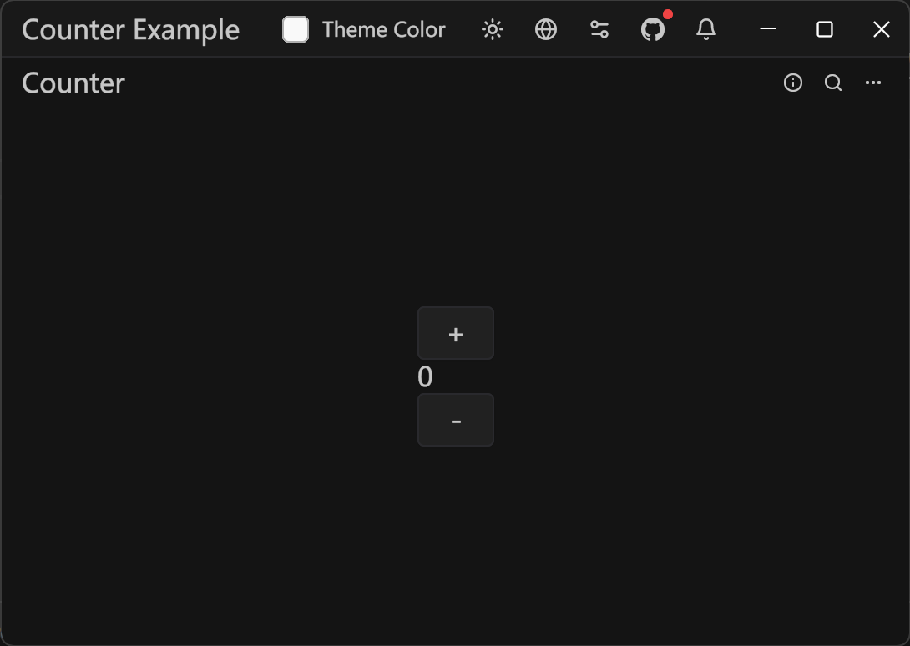

---

## **v0.1版成果：4. 配置工具**

- 配置文件格式：
    - Atom (静态版的AutoConfig，相当于JSON+XML)
    - AutoConfig（可编程的配置语言）
- AutoGen：
    - 基于模板（语法为AutoTemplate）
    - 可生成任意形式的文本，包括代码

---

## **Auto语言的独特之处**

<style scoped>
section {
    columns: 2;
}

h2 {
    column-span: all;
}

h3 {
    break-before: column;
}
</style>

### 设计

- ATOM
- 微内核+模块化
- 面向场景
- 编译期运算
- 跨生态

### 实现

- OOP：组合+特征
- 泛型：基于特征判定式

---

## **Auto语言：Atom**

<style scoped>
section {
    columns: 2;
}

h2 {
    column-span: all;
}

h3 {
    break-before: column;
}
</style>


```js
// Better JSON
version: "1.0" // Pair也是基本单位
// 数组
types: ["int", "float", "str"]
// 对象
{
    type: "object"
    age: 18
    gender: "male"
}
```

###

```js
// Better XML
class(name: "三年级3班", counts: 30) {
    // sub nodes
    student(name: "张三", age: 10) {
        course(name: "数学", score: 95) {}
        course(name: "语文", score: 90) {}
    }
    student(name: "李四", age: 11) {
        course(name: "数学", score: 96) {}
        course(name: "语文", score: 91) {}
    }
}
```
---

## **Auto语言：微内核+模块化**

1. 内核：静态（没有malloc/free）、单核（没有并发）
2. 语言模块：根据底层操作系统的支持决定是否开关
3. 标准库：根据语言模块划分

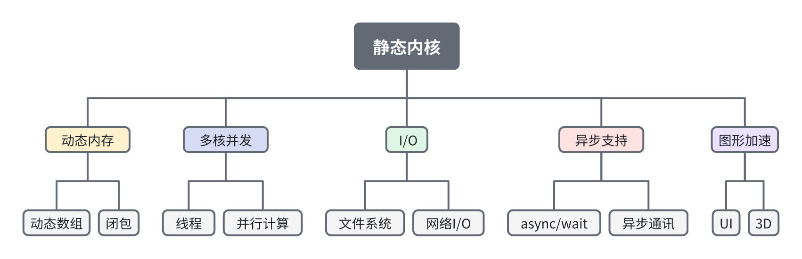

---

## **Auto语言：面向场景**

<style scoped>
section {
    columns: 2;
}

h2 {
    column-span: all;
}

h3 {
    break-before: column;
}

pre {
    font-size: 0.8em;
}
</style>

### 场景1：配置语言

```rust
port("cmake", "win32") {
    dep("kernel") {
        heap: "heap_5"
        port: "msvc/x64"
        config: "config/WIN32"
    }
}
dep("osal") {
    modules: ["Bsw/modules"]
}
app("demo") {
    if WIN32 { dir("App/win32") }
    links: ["osal"]
}
```

### 场景2：模板

```xml
var class_info = load_class_info()

<class name="${class_info.name}">
$ for student in class_info.students {
    <student name="${student.name}" age="${student.age}">
    $ for course in student.courses {
        <course name="${course.name}" score="${course.score}" />
    $ }
    </student>
$ }
</class>
```

---

## **Auto语言：面向场景：续**

<style scoped>
section {
    columns: 2;
}

h2 {
    column-span: all;
}

h3 {
    break-before: column;
}

pre {
    font-size: 0.8em;
}
</style>


### 场景3：动态脚本

```rust
// 脚本里才允许的var存量
var a = 1
// var存量可以改变类型
a = "String"
a = {
    name: "auto",
    versions: ["0.1", "0.2", "0.3"]
}
// 动态脚本中，函数参数可以不设定类型
fn add(a, b) {
    a + b
}
print(add(5, 8))
```

### 场景4：静态库

```rust
scene static

use std.types: with_op 
// Const
const PI = 3.1415926f
// 全局变量必须用global声明，相当于Singleton模式
global GlobalStatus = 1

// 函数必须指定类型，此处为泛型
fn mult(a T, b T) T if T.with_op('*') {
    a * b
}
```

---

## **Auto语言：编译期计算+泛型**

```rust
// const赋值会触发解释器
const assets = std.fs.read("assets.at")
```

```rust
// 可以用于泛型
fn HasLen(t Type) bool {
    t.field("len")?.is_type(uint)
}

fn grow_size(a T) if HasLen(T) {
    a.len * 2
}
```

---

## **Auto语言：特征与多态**

<style scoped>
section {
    columns: 2;
}

h2 {
    column-span: all;
}

h3 {
    break-before: column;
}

pre {
    font-size: 0.8em;
}
</style>


```rust
// 特征
spec Flyable {
    fn fly()
}

// 类型实现
type Duck as Flyable {
    fn fly() {
        print("quack quack, up the sky!")
    }
}

type Hawk as Flyable {
    fn fly() {
        print("I see you")
    }
}
```

###

```rust
// 多态
let birds = [Duck(), Hawk()]
for bird in birds {
    bird.fly()
}
```

---

## **Auto语言：v0.2规划**

- 语言：完善已实现特性；场景检验
- 标准库：math, string, io, fs, net
- 解释器：接入python生态；字节码（AIR）
- 转译器：完善C/Rust/UI的转译；初步添加Python/JS的转译
- Automan：完善C/Auto编译支持；添加更多的输出；测试框架
- AutoUI：完成两个小工具的界面：AutoMan和AutoGen
- AutoShell：基于nushell，脚本语言切换成Auto

---

## **Auto的未来**

**One Lang to Rule Them All**
- 实现真正的Language as OS
- 突破语言不可能三角
- 引入AI

---

## **真正的LaOS**

- 在MCU中，通过C实现操作系统的各个功能
    - 参考RTTread的模块化操作系统
- 在SOC/PC中，通过Rust实现OS之上的“虚拟OS”
    - 解释器相当于容器虚拟机
    - 编译器相当于容器加速器
    - 参考Chrome浏览器+WASM

---

## **语言不可能三角**

- 开发效率（Productivity）
- 运行性能（Performance）
- 程序安全（Security）


---

## **几种语言对比**

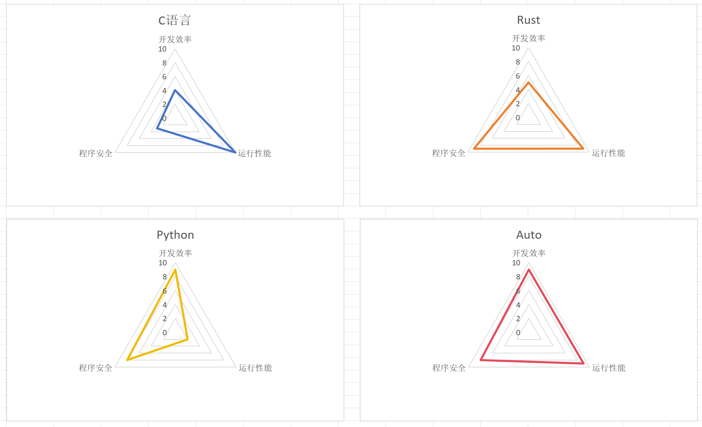

---
## **几种语言对比**

Auto语言怎么可能做到？

<style scoped>
ul {
    font-size: 0.9em;
}
</style>

- 开发时用动态脚本 
    * AutoScript ~= Python
- 发布时转化成静态代码
    * AutoLang ~= C/Rust
- 问题：如何实现自动转化？

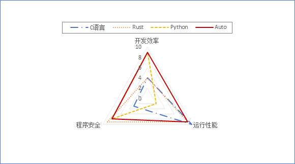

---

## **Auto的未来：AI**

这个事只有AI能做好：
- 类型标注：AutoScript -> AutoLang
- 安全检查：生命周期
- Notebook交互：用自然语言实时操纵数据/图表
- AI直接生成代码

---

# **Thanks**

<style scoped>
ul {
    font-size: 0.8em;
}
</style>

- 赵普明
- puming.zhao@soutek.cn
- [AutoStack](https://gitee.com/auto-stack)


