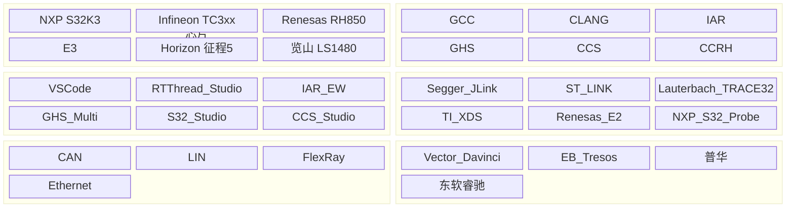
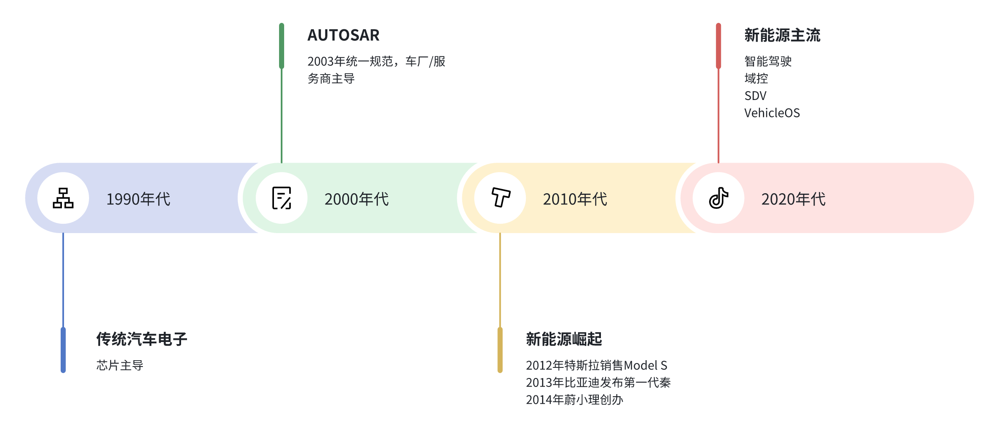

## 开场

- 介绍Auto语言
- 介绍车载行业
- 介绍OS
  - 嵌入式RTOS
  - LaOS

## Why

- 为什么要做Auto语言
    - 为什么要翻译成C
    - 为什么不用Rust/Zig/C++
    - 配置语言->完整语言

### MCU开发

- 编译器
- IDE
- 各种芯片
- 引脚配置工具
- 各种宏
- 各种工具链

- Rust不是微内核的语言

- Language as OS

## 车载MCU与RTOS

车载MCU开发的历史和现状。

时间线

- C语言的问题

## 现有解决方案

### AUTOSAR

- Vector
- 普华
- GRC

### AUTOSAR的问题

- MCU资源不足，导致所有的配置最终都要转化成C代码。
- 用C+配置+UI工具，相当于了一个“拙略的编译器”。
- 过度泛化，导致事无巨细都要配置。
- 封闭、昂贵
- 硬件绑定
- 生态破碎

引用福特CEO的话：

### RTOS vs Linux vs Android

## Auto语言

定位：打辅助。
思路：Code first

解决了哪些问题？

- 配置生成
    - 配置语言；对比DML
    - AutoUI：UI界面配置
    - Shema：自动校验；UI自动生成。
- 模块化/抽象化
    - AutoMan：编译器和硬件的自由切换
    - AutoMan: 模块化、层次化
    - AutoTest: 单元测试、集成测试、网络测试、UI测试

### HAL

- 每家都有自己的HAL
- MCAL vs HAL

### 总结

MCU开发生态，实际上是在（用粗笨的手段）模拟一个大编译器。

- C的MCU开发图：（M*N）
- LLVM的开发图： M+N；LLIR
- OS的抽象层：M+N；系统调用

### MCU vs SOC

- C vs C++
- RTOS vs Linux
- CAN/LIN vs Ethernet/TCP/IP
